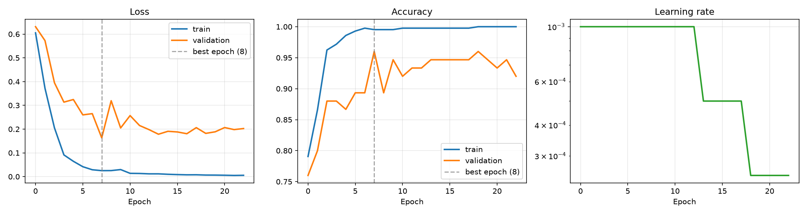
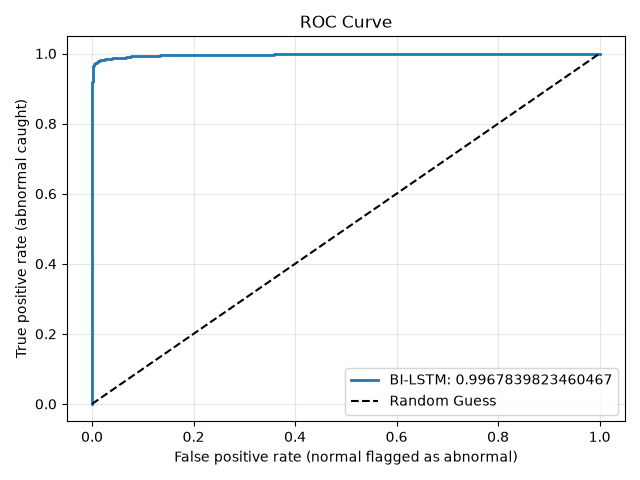
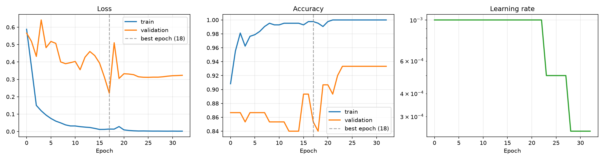
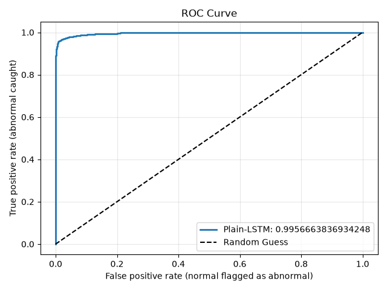

# ECG Heartbeat Anomaly Detection: LSTM, Bidirectional LSTM and XGBoost

Binary classification of heartbeats (normal versus abnormal) on the ECG5000 benchmark dataset. The project compares two recurrent neural networks built with TensorFlow and Keras (a plain LSTM and a Bidirectional LSTM) against a tuned XGBoost classifier trained on the raw signal values. It includes an interactive Streamlit demo of the two neural networks.

Live demo: https://ecg-data.streamlit.app

## Summary

| Model | Test Accuracy | Abnormal Recall | Abnormal Precision | F1 | ROC AUC |
| :- | :- | :- | :- | :- | :- |
| LSTM | 96.22% | 91.19% | 99.71% | 0.953 | 0.9957 |
| Bidirectional LSTM | 97.29% | 93.65% | 99.83% | 0.966 | 0.9968 |
| XGBoost | 97.20% | 94.07% | 99.16% | 0.965 | 0.9974 |

All figures are measured on 4,500 heartbeats that the models never saw during training. The Bidirectional LSTM outperforms the plain LSTM on every metric. A tuned XGBoost classifier trained on the raw signal values performs on par with the Bidirectional LSTM: the two differ by 4 correctly classified beats out of 4,500, which is well within run-to-run variation. On this benchmark, the extra complexity of a recurrent network brings no measurable advantage over a tree ensemble.

Note that the comparison is not equal in tuning effort: XGBoost's hyperparameters were selected by cross-validated search over 40 candidate settings, while the two neural networks use one fixed architecture and were not tuned.

## Problem Statement

An electrocardiogram (ECG) records the electrical activity of the heart. Each heartbeat has a characteristic shape, and deviations from that shape can indicate arrhythmias. The goal of this project is to classify a single recorded heartbeat as normal or abnormal directly from its raw signal, without hand-crafted features.

This is a sequence classification task. The order of values within a heartbeat carries information, which motivates recurrent architectures. The project also tests whether a model that ignores the sequence structure and treats the 140 values as independent columns can do as well.

## Dataset

The project uses ECG5000, originally from the UCR Time Series Classification Archive. The data was obtained through Kaggle (`salsabilahmid/ecg50000`) and is downloaded automatically with `kagglehub`.

| Property | Value |
| :- | :- |
| Total heartbeats | 5,000 |
| Training file | 500 heartbeats |
| Test file | 4,500 heartbeats |
| Time steps per heartbeat | 140 |
| Features per time step | 1 |
| Original classes | 5 |

The original labels are:

| Label | Meaning |
| :- | :- |
| 1 | Normal |
| 2 | R-on-T premature ventricular contraction |
| 3 | Premature ventricular contraction |
| 4 | Supraventricular premature or ectopic beat |
| 5 | Unclassifiable beat |

For this project the task is binary. Label 1 is mapped to 0 (normal), and labels 2 to 5 are merged into 1 (abnormal).

| Split | Normal (0) | Abnormal (1) |
| :- | :- | :- |
| Train | 292 | 208 |
| Test | 2,627 | 1,873 |

The official UCR split of 500 training and 4,500 test samples is kept as is. This makes the results comparable with published work on the same benchmark.

## Method

### Preprocessing for the neural networks

1. Load the `.ts` files and parse each row into 140 signal values and a label.
2. Convert labels to binary.
3. Standardize the signal with `StandardScaler`. The scaler is fit on the training set only and then applied to the test set, which prevents information from the test set leaking into training.
4. Reshape the arrays to `(samples, 140, 1)`, the input shape expected by recurrent layers.

### Neural network models

The two networks share the same structure. The only difference is the recurrent layer.

| Layer | LSTM model | Bidirectional LSTM model |
| :- | :- | :- |
| Input | (140, 1) | (140, 1) |
| Recurrent | LSTM(64) | Bidirectional(LSTM(64)) |
| Regularization | Dropout(0.3) | Dropout(0.3) |
| Output | Dense(1, sigmoid) | Dense(1, sigmoid) |

A Bidirectional LSTM reads each heartbeat forward and backward and combines both views. This suits the task because each heartbeat is fully recorded before classification, so the later part of the signal can inform the interpretation of the earlier part.

Training configuration:

| Setting | Value |
| :- | :- |
| Optimizer | Adam |
| Loss | Binary cross-entropy |
| Maximum epochs | 100 |
| Validation split | 15% of the training data (75 heartbeats) |
| Random seed | 42, with TensorFlow deterministic operations enabled |
| EarlyStopping | Monitor validation loss, patience 15, restore best weights |
| ReduceLROnPlateau | Monitor validation loss, factor 0.5, patience 5, minimum learning rate 1e-5 |
| ModelCheckpoint | Save the best model by validation loss |
| TensorBoard | Separate log directory for each model |

### XGBoost baseline

XGBoost treats each heartbeat as 140 independent numeric features. It has no built-in notion of time order, which makes it a useful baseline for the recurrent models.

| Setting | Value |
| :- | :- |
| Features | The 140 raw signal values, no scaling |
| Hyperparameter search | RandomizedSearchCV, 40 candidates |
| Cross-validation | 5-fold stratified, on the training set only |
| Search metric | ROC AUC |
| Other settings | Histogram tree method, random seed 42 |

The test set is used once, after the search, to produce the reported numbers. The best parameters found are shown in the XGBoost notebook.

## Results

### Test Set Performance

| Metric | LSTM | Bidirectional LSTM | XGBoost |
| :- | :- | :- | :- |
| Accuracy | 0.9622 | 0.9729 | 0.9720 |
| Recall (abnormal) | 0.9119 | 0.9365 | 0.9407 |
| Precision (abnormal) | 0.9971 | 0.9983 | 0.9916 |
| F1 score | 0.9526 | 0.9664 | 0.9655 |
| ROC AUC | 0.9957 | 0.9968 | 0.9974 |
| Missed abnormal beats | 165 | 119 | 111 |
| False alarms | 5 | 3 | 15 |

### Confusion Matrices (Test Set)

Rows are actual classes and columns are predicted classes.

LSTM:

| | Predicted normal | Predicted abnormal |
| :- | :- | :- |
| Actual normal | 2,622 | 5 |
| Actual abnormal | 165 | 1,708 |

Bidirectional LSTM:

| | Predicted normal | Predicted abnormal |
| :- | :- | :- |
| Actual normal | 2,624 | 3 |
| Actual abnormal | 119 | 1,754 |

XGBoost:

| | Predicted normal | Predicted abnormal |
| :- | :- | :- |
| Actual normal | 2,612 | 15 |
| Actual abnormal | 111 | 1,762 |

### Training Versus Test

| Model | Metric | Train | Test |
| :- | :- | :- | :- |
| Bidirectional LSTM | Accuracy | 0.990 | 0.973 |
| Bidirectional LSTM | Recall (abnormal) | 0.981 | 0.936 |
| Bidirectional LSTM | ROC AUC | 0.999 | 0.997 |
| XGBoost | Accuracy | 0.998 | 0.972 |
| XGBoost | Recall (abnormal) | 0.995 | 0.941 |
| XGBoost | ROC AUC | 1.000 | 0.997 |

Both models generalize well. XGBoost fits the 500 training beats almost perfectly, which is typical of tree ensembles on small data, and its test performance is still excellent.

### Figures

Bidirectional LSTM training curves (loss, accuracy, and learning rate schedule):



Bidirectional LSTM ROC curve:



Plain LSTM training curves:



Plain LSTM ROC curve:



## Discussion

1. All three models separate the two classes very well, with ROC AUC above 0.995. Differences in AUC between them are at most 0.002.
2. The Bidirectional LSTM improves on the plain LSTM on every metric. It detects 46 more abnormal beats and raises fewer false alarms.
3. XGBoost on the raw signal matches the Bidirectional LSTM. Accuracy differs by 0.1 percentage points, which corresponds to 4 beats out of 4,500. With a single run per model, this should be read as a tie, not a ranking. Because XGBoost was tuned and the neural networks were not, this comparison favors XGBoost. Tuning the networks (units, dropout, learning rate, depth) could narrow or reverse the small differences seen here, so the result should not be read as showing that trees are better than recurrent networks in general.
4. The models make different kinds of errors. XGBoost misses fewer abnormal beats (111 against 119) but raises more false alarms (15 against 3). The Bidirectional LSTM is more conservative.
5. A plausible explanation for the strong tree result is that ECG5000 heartbeats are already segmented and aligned to 140 fixed time points, so each column corresponds to a similar phase of the heartbeat and trees can split on individual positions directly. This explanation has not been tested in this project.
6. The main weakness of all models is missed abnormal beats at the default 0.5 threshold. Because the AUC is high, this is largely a matter of the decision threshold, not a lack of separability. In a screening setting, a lower threshold would trade some precision for higher recall.
7. Early stopping selected the best validation epoch for the neural networks, and the learning rate schedule reduced the rate in steps as validation loss plateaued.

## Interactive Demo

Live demo: https://ecg-data.streamlit.app

### What it is

The demo is a small web application for exploring what the two trained neural networks do on real heartbeats. It runs in a browser, so nothing needs to be installed. It draws from the 4,500 heartbeats of the held-out test set, which the models never saw during training. It is a way to inspect the classifiers on individual examples, not a tool for analyzing new recordings. The XGBoost baseline is reported in this README but is not part of the demo.

### How to use it

The page has three tabs.

1. Try it: choose the kind of heartbeat (any, normal, or abnormal) and press the button to draw a random one. The page shows the heartbeat plotted against the average normal heartbeat, the label recorded in the dataset (including the abnormality type for abnormal beats), and the verdict of each model with its estimated chance of abnormal. Each verdict is marked correct or incorrect, followed by a one-line summary of whether the models agree.
2. Performance: the test metrics for both models and the saved training and ROC figures.
3. About: a short description of the data, the models, the limitations, and a link to the source code.

An optional "Advanced" section on the first tab contains the decision threshold. A heartbeat is called abnormal when the model's chance of abnormal is above the threshold, which is 50 percent by default. Lowering it catches more abnormal beats at the cost of more false alarms.

### Why it is useful

- Access: a reader can evaluate the project in seconds, without cloning the repository or installing TensorFlow.
- Transparency: it shows individual successes and failures, not only summary metrics. Visitors can look for heartbeats the models get wrong and see that some are genuinely hard to tell apart.
- Model comparison: both networks run on the same heartbeat, so the difference between the LSTM and the Bidirectional LSTM can be seen on concrete examples.
- Threshold trade-off: the threshold control shows how recall and false alarms trade off, which supports the finding that the main weakness is recall at the default threshold.
- End-to-end check: the demo loads the saved models and the saved scaler and applies them exactly as in training, which confirms that preprocessing, saving, loading, and inference work outside the notebook.

The app files are `app.py` and `export_demo_data.py`. The exported test beats are stored in `demo_data/`. The free hosting tier puts inactive apps to sleep, so the first visit after a quiet period may take about a minute to start.

## Limitations

- Results come from a single run per model with seed 42. Differences of about one percentage point between models could be due to random variation. Averaging over several seeds would give a more reliable comparison.
- The tuning effort is not equal across models. XGBoost was tuned with cross-validated search over 40 candidate settings, while the neural networks use one fixed architecture and a 75-beat validation split for early stopping.
- The validation set for the neural networks contains only 75 heartbeats, so validation curves are noisy and should be interpreted cautiously.
- Only one dataset was used, and it is a clean, pre-aligned benchmark. Performance on signals from other devices, patients, or recording conditions is unknown.
- The binary formulation merges four abnormal beat types, so the models do not identify which type of abnormality is present.
- This project is a machine learning exercise on a public benchmark. It is not a medical device and must not be used for diagnosis or clinical decisions.

## Project Structure

```
.
├── src/
│   └── load_data.py                 Dataset download and parsing functions
├── model.ipynb                      Bidirectional LSTM experiment
├── model_plain_lstm.ipynb           Plain LSTM experiment
├── model_xgboost.ipynb              XGBoost baseline
├── app.py                           Streamlit demo application
├── export_demo_data.py              Exports the raw test beats for the demo
├── demo_data/                       Test beats and labels used by the demo
├── images/                          Saved figures (training curves, ROC curves)
├── checkpoints/                     Saved best models (Bidirectional LSTM and plain LSTM)
├── scaler/                          Fitted StandardScaler
├── models/                          Saved XGBoost model
├── logs/                            TensorBoard logs (not tracked in Git)
├── requirements.txt                 Dependencies for the demo
├── requirements_notebooks.txt       Dependencies for the training notebooks
├── requirements_xgboost.txt         Dependencies for the XGBoost notebook
├── .gitignore
└── README.md
```

## Setup

Requirements:

- Python 3.12
- TensorFlow 2.16.2 and Keras
- NumPy, pandas, scikit-learn, Matplotlib, Seaborn, joblib, kagglehub, XGBoost (notebooks)
- Streamlit and pandas (demo)

The training notebooks and the demo use separate virtual environments. Recent Streamlit releases require a newer protobuf than TensorFlow 2.16.2 supports, so installing both in one environment can break TensorFlow. The pinned versions in `requirements.txt` avoid this conflict.

Training environment:

```bash
python -m venv tf_env
source tf_env/bin/activate
pip install -r requirements_notebooks.txt
```

Demo environment:

```bash
python -m venv demo_env
source demo_env/bin/activate
pip install -r requirements.txt
```

## Usage

### Train the models

1. Activate the training environment.
2. Open `model.ipynb` to run the Bidirectional LSTM experiment, `model_plain_lstm.ipynb` for the plain LSTM experiment, or `model_xgboost.ipynb` for the XGBoost baseline.
3. Run the cells from top to bottom. The dataset is downloaded automatically on the first run through `kagglehub`.
4. Figures are saved to `images/`, the neural network models to `checkpoints/`, the fitted scaler to `scaler/`, and the XGBoost model to `models/`.

To view training curves interactively, launch TensorBoard from the project folder and point it at the `logs` directory.

### Run the demo

1. Activate the demo environment.
2. Export the test beats once (this step needs `kagglehub` and Kaggle access, so run it in the training environment if it is not installed in the demo environment):

```bash
python export_demo_data.py
```

3. Start the app from the project folder:

```bash
python -m streamlit run app.py
```

The app opens at `http://localhost:8501`. The exported files and the committed models and scaler are already included in the repository, so a fresh clone can skip step 2.

## Reproducibility

The neural network notebooks set the Python, NumPy, and TensorFlow random seeds to 42 and enable deterministic TensorFlow operations. The XGBoost search uses random seed 42 for both the cross-validation splits and the sampling of candidate settings. Restart the kernel and run all cells in order to reproduce the reported numbers. Exact values may differ across hardware, operating systems, and library versions.

## Possible Extensions

- Repeat training over multiple seeds for every model and report the mean and standard deviation.
- Give the neural networks a comparable tuning budget, for example with Keras Tuner, and compare again.
- Compare against a one-dimensional convolutional network.
- Check which time steps XGBoost relies on, using feature importance or SHAP, and compare with where the recurrent models focus.
- Select the decision threshold on a validation set to improve recall on abnormal beats, and report recall and false alarms across thresholds.
- Extend to the original five-class problem with class weighting for the rare classes.
- Add the XGBoost model to the demo as a third column.

## Acknowledgments

- ECG5000 dataset from the UCR Time Series Classification Archive.
- Kaggle dataset mirror: `salsabilahmid/ecg50000`.